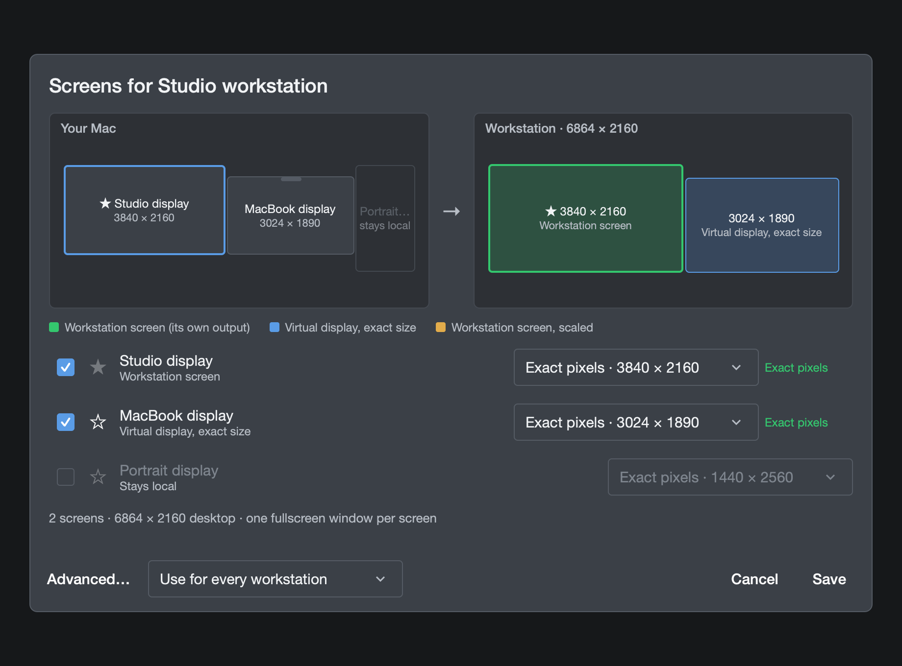

<p align="center">
  
</p>

<h1 align="center">BDE Fernweh</h1>

<p align="center">
  <strong>A PLANK fork shaped by everyday creative work.</strong><br>
  Thoughtful display matching, studio access, collaboration and fixes for the moments that interrupt a session.
</p>

<p align="center">
  <a href="#your-displays-matched">Display matcher</a> ·
  <a href="#creative-input-with-an-escape-route">Creative input</a> ·
  <a href="#the-fixes-that-make-a-difference">Bug fixes</a> ·
  <a href="docs/fernweh/build.md">Build it</a> ·
  <a href="#built-on-plank-built-to-give-back">Upstream &amp; contributing</a>
</p>

> **ALPHA · private review · build from source**<br>
> Build the executables you need. The Client is **direct-only by default**; broker support is a build-time opt-in. These repositories remain private while we prepare them for community review.

## Why Fernweh?

We use remote workstations for demanding creative applications. That means
mixed-resolution displays, drawing tablets, keyboard shortcuts, long sessions
and reconnecting to a desktop that already has work open.

[PLANK](https://github.com/instinctual/plank) provides the foundation: remote
video and audio, exact-format color profiles, workstation authentication, input
and encrypted QUIC transport. Fernweh builds on that work with our studio
workflows and a growing set of display, input and session-recovery improvements.

<table>
  <tr>
    <td width="50%" valign="top"><strong>Your desk, translated</strong><br>Choose which screens participate, preview the remote layout and save it for the next time you connect.</td>
    <td width="50%" valign="top"><strong>Creative tools stay familiar</strong><br>Forward Mac shortcuts, keep pointer placement aligned across displays and retain local disconnect controls.</td>
  </tr>
  <tr>
    <td valign="top"><strong>One workstation or a studio</strong><br>Connect directly, or add our optional self-hosted broker for sign-in, workstation discovery and outside access.</td>
    <td valign="top"><strong>Work worth sharing</strong><br>Preserved PLANK history, documented fixes and component-sized contributions that can travel back upstream.</td>
  </tr>
</table>

## Your displays, matched

**See what your remote desktop will look like before connecting.** The display
matcher shows your local monitors alongside the workstation layout, including
which outputs are physical and which are virtual.

<p align="center">
  
</p>

<p align="center"><em>Actual Fernweh interface rendered on macOS with sample display data. No live workstation or account is shown.</em></p>

- **Use the screens you want.** Keep a spare monitor local, choose the remote
  primary and open one fullscreen window per participating screen.
- **Choose pixels or comfortable text.** Select exact pixels, a Retina
  “looks like” size, a preset or a supported custom size. The planner checks
  Host capabilities and decoder limits.
- **Remember each desk.** Save a profile for a particular monitor set, globally
  or for an individual workstation.
- **Handle changes deliberately.** When screens change during a session, review
  the proposed layout or keep the current one. The notice follows normal
  toolbar hiding, and Keep remembers that arrangement for the session.

### Need more control?

The advanced view lets you place displays by hand with snapping, enter exact
sizes and coordinates, choose physical or virtual backing, and select native
pixels or scale-to-fit presentation.

<p align="center">
  
</p>

<p align="center"><em>The same sample desk in the real advanced view. <a href="docs/fernweh/media/README.md">Capture source and reproduction</a>.</em></p>

Display selection and Client matching also exist in PLANK. Our additions include
this profile-based workflow, mixed physical/virtual arrangements, per-monitor
windows and the downstream layout/recovery fixes described below. Available
layouts still depend on the Host and Client combination.

## Creative input, with an escape route

### Included: immersive keyboard and more dependable pointing

On macOS, **immersive keyboard mode** forwards ordinary shortcuts to the focused
remote desktop, including Option-Tab as remote Alt-Tab. It is useful when
working in Blender and other shortcut-heavy creative applications. Enable it
in Settings for your next connection; macOS Accessibility permission is
required and protected system shortcuts remain local.

The input work also covers first-click handling, pointer mapping through
letterboxing and multiple display windows, cross-screen dragging, and Linux
scroll-wheel device handling. Tablet paths remain platform-specific; see the
[feature and source map](docs/fernweh/enhancements.md).

| Local control | Shortcut |
| --- | --- |
| Disconnect the focused session | **Ctrl + Alt + Shift + Q** |
| Show or hide the session toolbar | **Ctrl + Alt + Shift + T** |
| Leave immersive keyboard mode for this session | **Ctrl + Alt + Shift + Z** |

On Mac, use **Control + Option + Shift**. Disconnect and toolbar controls remain
local during immersive keyboard capture, including while reconnecting.

### Merged source: immersive mouse for Blender and similar tools

Applications that hide or wrap the pointer need more than ordinary desktop
pointing. Our **immersive mouse** work adds an explicit session toggle for
continuous relative movement, with a toolbar action and
**Ctrl + Alt + Shift + M** to enter or release capture. It is designed for tools
such as Blender and Unreal, rather than an application-specific workaround.

The coordinated Client, Host, input library and protocol source is now merged.
Its current path is the **Mac Qt Client → Linux X11 Host**. The standard Mac
packaging script still selects the established SDL frontend; enabling this mode
in that default build awaits the Qt adapter's display/clipboard/sharing parity.
Blender/Unreal hands-on acceptance is also open. See the
[integration status](docs/fernweh/upstream-integration-2026-11-14.md).

## The fixes that make a difference

Remote access needs to survive the transitions around the work, too. These are
specific repairs carried by this fork, with their original implementation notes.

| When something went wrong | What we changed |
| --- | --- |
| A fresh Linux login or display modeset could crash a media worker during encoder recreation | Keep direct NVENC teardown on its CUDA context thread, retain each session's context and drain conversion work before releasing borrowed frames. [Encoder lifetime](docs/releases/1.2.30.md) |
| A layout change could leave recovery ownership behind, overlap boot displays or return the remaining window to the wrong screen | Retain the original layout until exact restoration succeeds, retry inventory publication, use native boot dimensions independently of the 60 Hz carrier and place the remaining window on the selected primary. [Display recovery](docs/releases/1.1.047.md) |
| Windows could forget a disabled monitor when starting a stream | Use stable Windows display identities and account for Qt/SDL scaling differences instead of rebuilding incompatible monitor keys. [Source and regression](docs/fernweh/enhancements.md#windows-display-selection) |
| A Windows stream could remain black after a lost recovery keyframe response | Retry recovery while delta frames continue; keep presentation nonblocking and release discarded hardware frames outside the pacer lock. [Video recovery](docs/releases/1.2.33.md) |
| Screen-change notices could linger or reappear after choosing Keep | Honor the ask-on-change preference, separate observed and applied geometry, remember Keep, and restore normal toolbar idle hiding. [Screen-change repair](docs/fernweh/enhancements.md#screen-change-notices) |
| A low selected bitrate could still allow large sender bursts | Derive a bounded packet-pacing ceiling from the selected bitrate and encoder peak, with scheduler headroom for ordinary wakeup delays. [Pacing](docs/releases/1.2.32.md) |

These are scoped fixes, not a promise that every crash or network freeze is
solved. The [enhancement map](docs/fernweh/enhancements.md) links implementation
commits and regression coverage. Exact 60 Hz virtual timings themselves are
inherited PLANK work; we credit that separately from our layout corrections.

## Keeping up with PLANK

We reviewed PLANK's recent releases through **1.4.18** and brought its independent
reliability fixes into this fork: queued NVENC refreshes, retiring-session retries,
bounded control requests, cancellable Linux audio, reliable-data backpressure and
Mac display wake recovery. The input boundary tests also exposed a missing
non-finite pen-coordinate check, which is now repaired.

The larger frontend and dependency migration remains separate because it must
preserve Fernweh's display profiles, shared sessions, file clipboard and Windows
path. The [release-by-release ledger](docs/fernweh/upstream-integration-2026-11-14.md)
records what landed, the evidence, and what is still outstanding.

## Studio access, when you want it

For a studio deployment, Fernweh adds an optional broker around the same remote
workstation core:

- **Sign in with FreeIPA password + OTP or a passkey.** Device-bound sessions
  and onboarding support everyday access after initial enrollment.
- **Find authorized workstations.** Workstation lists follow explicit directory
  access policy, with desktop handoff/recovery and separately authorized sharing.
- **Connect inside or outside the office.** Use a direct office connection or
  a scoped TCP/UDP relay lease. Media remains encrypted to the Host.
- **Share an existing desktop deliberately.** Presence, joining and control
  sharing follow the collaboration/admission contracts.
- **Enable managed updates and diagnostics if needed.** Both have explicit
  deployment policy; diagnostics collection is opt-in.

The broker currently integrates with **FreeIPA/Kerberos**. Broker admission,
file clipboard and collaboration require the matching Fernweh components;
support varies by platform. Start with the [integration guide](docs/fernweh/broker.md).

## Build exactly what you need

You choose the executables and features for your deployment. **A direct Client
and Host do not need the broker or a directory service.**

| You want… | Build… |
| --- | --- |
| Direct workstation access over a reachable LAN/VPN/admin-managed route | A Client with the default `FERNWEH_BROKER_ENABLED=0`, plus a compatible Host |
| Studio sign-in, workstation discovery and brokered access | A Client with `FERNWEH_BROKER_ENABLED=1`, compatible Hosts and the broker; add the relay helper for relay access |
| Only one side of an existing setup | Just that Client, Host or broker component |

```sh
gh auth setup-git
git clone --recurse-submodules=no https://github.com/best-day-ever/fernweh.git
cd fernweh

# Initialize only the Client and shared transport for a Client build.
git submodule update --init --recursive apps/client third_party/kyber-kymux

# The default. Broker backends, account UI and helpers are omitted.
export FERNWEH_BROKER_ENABLED=0
# Continue with your platform's build guide below.
```

For a broker-enabled build, set `FERNWEH_BROKER_ENABLED=1` before building.
The endpoint, public TLS pins, passkey RP ID and update opt-in are deployment
variables. Generic builds contain no BDE endpoint or default trusted broker key.
Secrets remain outside Git. A disabled build ignores inherited broker settings.

**[Choose your components](docs/fernweh/build.md#choose-your-components)** ·
**[All build variables](docs/fernweh/configuration.md)** ·
**[Broker and Host integration](docs/fernweh/broker.md)**

### Platforms

| Product | Target | Build instructions |
| --- | --- | --- |
| macOS Client | Apple Silicon, macOS 15+; SDK 27+ builder | [Build Client](docs/fernweh/build.md#macos-client) |
| Windows Client | x64, MSVC 2022, Qt 6.10.2; ALPHA MSI tooling | [Build Client](docs/fernweh/build.md#windows-client) |
| Linux Client | Ubuntu 26.04 x86-64, Qt/Wayland | [Build Client](docs/fernweh/build.md#linux-client) |
| Linux Host | Rocky 9.7 x86-64, NVIDIA/X11 | [Build Host](docs/fernweh/build.md#linux-host) |
| macOS Host | Apple Silicon, macOS 26.7+; SDK 27+ builder | [Build Host](docs/fernweh/build.md#macos-host) |
| Broker / relay | Rocky 9.7 x86-64, Rust | [Build services](docs/fernweh/broker.md) |

Private review access is currently needed for the parent, Client and Linux Host
repositories. Use the pinned submodule commits. Linux Host builds initialize
`apps/host/linux` instead of the Client. There is no Windows Host or mobile
product in this review. See [platform boundaries](docs/development/platforms.md)
for color, capture, audio, tablet and display support.

## Built on PLANK. Built to give back.

We want this work to be useful beyond our studio. PLANK's media, color, input
and transport work is the foundation, and we preserve its history and notices.
Fernweh is an independent downstream project, without an upstream endorsement.

**We also check what upstream has improved.** Our
[14 November 2026 comparison](docs/fernweh/upstream-review-2026-11-14.md) found
useful fixes not yet integrated here: retained NVENC keyframe requests, retrying
while a previous Host session retires, reliable-data backpressure and Mac
display-wake/installer improvements. Fernweh's studio features and fixes do not
make it universally ahead of current PLANK.

The [upstreaming guide](docs/fernweh/upstreaming.md) explains how to extract a
small fix, test it against current PLANK and preserve original authorship.
The full FreeIPA broker is an optional subsystem; a focused bug fix should not
require it. Public submissions and repository publication follow review.

### For contributors, Claude Code and Codex

| Start here | What it covers |
| --- | --- |
| [Contributing](CONTRIBUTING.md) | Project scope, changes and review |
| [Development guide](docs/fernweh/development.md) | Component ownership, builds and validation |
| [Shared development skill](.agents/skills/fernweh-development/SKILL.md) | Repository workflow for Codex and Claude Code |
| [Feature and source map](docs/fernweh/enhancements.md) | Included changes, source evidence and upstream contribution units |
| [Upstream comparison](docs/fernweh/upstream-review-2026-11-14.md) | Current gaps, overlap and recommended integration order |

### Review status

Both direct-only and broker-enabled Mac Client developer builds have passed
their recorded checks. This source review supplies no binaries; native
Windows/Linux builds, installed-session acceptance and publication review remain
separate gates. The [verification receipt](docs/fernweh/review.md) records exact
commits, checks and remaining work. Historical BDE/PLANK release notes describe
their original sources and packages.

## Credits and licenses

Thank you to the [PLANK contributors](https://github.com/instinctual/plank),
[Sunshine](https://github.com/LizardByte/Sunshine),
[Moonlight Qt](https://github.com/moonlight-stream/moonlight-qt), Kyber/Kymux,
Quinn, Qt, SDL, FFmpeg and the other communities this project depends on.

Component licenses and copyrights remain in place. The Client and Linux Host
retain their GPLv3 license texts; the broker and shared transport declare
AGPL-3.0-or-later. Dependencies carry their own terms. See
[licensing and provenance](docs/fernweh/provenance.md).
