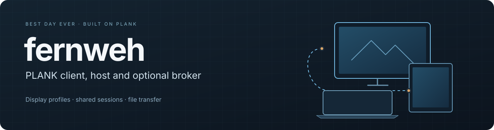
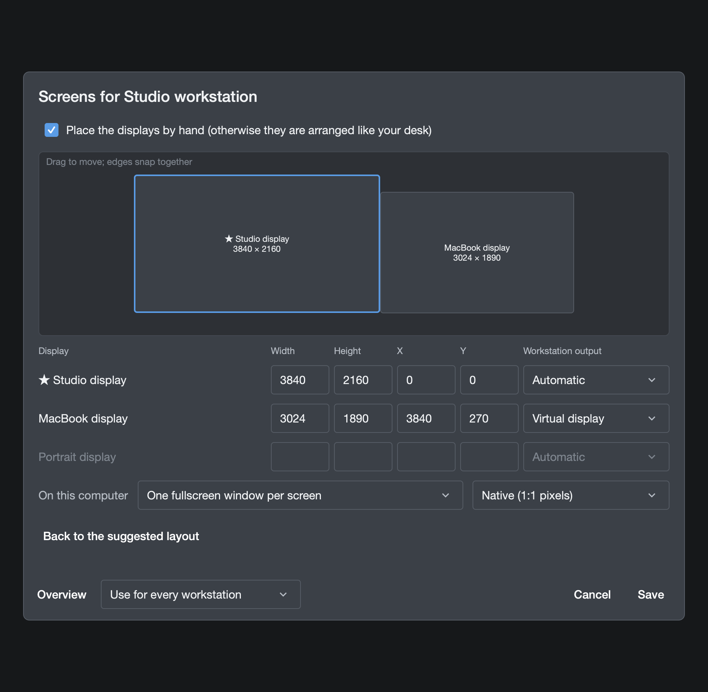

<p align="center">
  
</p>

<h1 align="center">BDE Fernweh</h1>

<p align="center">
  A source fork of <a href="https://github.com/instinctual/plank">PLANK</a> with desktop collaboration,
  display profiles, file transfer and an optional access broker.
</p>

<p align="center">
  <a href="#changes-from-plank">Changes</a> ·
  <a href="#display-configuration">Screenshots</a> ·
  <a href="docs/fernweh/build.md">Build</a> ·
  <a href="docs/fernweh/enhancements.md">Implementation map</a> ·
  <a href="docs/fernweh/merged-history.md">Merged history</a> ·
  <a href="docs/fernweh/upstreaming.md">Contribute upstream</a>
</p>

> **ALPHA · build from source**<br>
> Build the Client, Host and services you need. The Client defaults to
> `FERNWEH_BROKER_ENABLED=0`; broker support is a compile-time option.
> Platform support and installed-session qualification are tracked separately.

## Relationship to PLANK

Fernweh preserves PLANK's Git history and component licenses. PLANK supplies the
media pipeline, exact-format color profiles, encrypted QUIC transport, audio,
OS account authentication, basic display selection, text clipboard and tablet
forwarding. The changes below are downstream additions or repairs to those
systems. This is an independent project, without an upstream endorsement.

The [implementation map](docs/fernweh/enhancements.md) documents behavior,
protocols, source files, original reviews and platform limits. The
[merged-history index](docs/fernweh/merged-history.md) covers the smaller fixes,
follow-up regressions, build changes and upstream imports as well as major features.

## Changes from PLANK

### Desktop sharing and join requests (knocking)

- An authenticated guest can request access to an occupied Linux desktop. The
  owner receives a consent window and can **Decline**, allow **View only**, or
  **Allow interaction**. Pending requests expire; no response grants no access.
- The owner can change a participant's permission or revoke access. Guest input
  is suspended before security controls become interactive, preventing another
  controller from approving requests or changing permissions.
- Each participant has an independent transport connection and relay lease.
  Leaving one session does not disconnect other participants. Guests inherit the
  owner's capture and display layout; joining cannot modeset the workstation.
- Host policy can allow authenticated workstation users to join automatically,
  restrict joining by group, or exempt a support group from consent. Optional
  **Unlock and join** rechecks the desktop identity and relocks after support
  leaves. These are separate administrator-controlled permissions.
- Shared input preserves drag ownership, hands the mouse over after inactivity,
  releases departing participants' held input and displays the active remote
  desktop pointer. There is one OS pointer, not one named pointer per person.

Guest clipboard, files, pen/raw HID, microphone and camera forwarding are denied.
Linux consent-based collaboration and broker-admitted shared Mac hosts have
separate contracts; do not infer the same consent UI on the Mac Host.
[Collaboration protocol](protocol/collaboration.md) ·
[Mac admission](protocol/macos-broker-admission.md)

### Multiple workstation sessions and presence

The Client can keep independent windows connected to different workstations.
Broker-enabled Clients publish per-stream presence with expiring heartbeats so
workstation cards show connected people. Occupancy and presence are advisory;
Host authentication and desktop policy still decide admission. Updates wait for
other Client windows and active sessions to close.
[Source and original PRs](docs/fernweh/enhancements.md#multiple-sessions-and-presence)

### File transfer and clipboard synchronization

- **Bidirectional files and folders:** Finder/Explorer copy and remote paste, or
  the Mac session toolbar's **Files…** picker. The picker preserves the local
  clipboard. Transfer state reports sending, receiving, completion and failure.
- **Separate text/file permissions:** Host policy and authenticated account
  groups can narrow each capability independently. File transfer is negotiated
  and default-off in Host policy; direct access does not require the broker.
- **Transfer lifecycle:** streamed manifests, bounded queues, range reads,
  integrity checks and staged completion. Collision handling, cancellation,
  silent-peer deadlines and queue backpressure prevent stranded transfers.
- **Text clipboard repairs:** preserve newer local clipboard ownership, isolate
  inbound/outbound generations, retry busy Windows clipboards and unsent chunks,
  avoid echoing received files, and defer paste until content is ready.

Basic text sync is inherited from PLANK. Fernweh adds the file protocol, Windows
adapters, per-user policy and downstream ownership/recovery work. Current file
adapters cover Mac/Windows Clients with the Linux X11 Host; this is not a claim
of equivalent file transfer on every Client/Host pair. Links, special files,
resource forks and extended attributes are outside the file protocol.
[File protocol](protocol/clipboard-files-v2.md) ·
[Text protocol](protocol/clipboard-sync.md) ·
[Platform details](docs/fernweh/enhancements.md#files-and-clipboard)

### Display profiles and session controls

The display planner adds saved monitor-set profiles, per-workstation overrides,
per-screen participation, primary selection, physical/virtual backing and exact
pixels versus Retina text-size choices. Advanced configuration supports explicit
sizes, coordinates and snapping. Mac SDL sessions retain separate monitor
windows and cross-screen dragging. Screen changes offer **Apply** or **Keep**
with session-scoped dismissal and normal toolbar hiding.

Other Client changes include per-profile bitrate controls, reserved local
session shortcuts, Mac immersive keyboard capture, Windows clipboard/tablet
adapters and stream-window close handling.
[Display configuration](#display-configuration) ·
[Input details](docs/fernweh/enhancements.md#input-and-local-session-controls)

### Immersive mouse

The merged Mac Qt Client → Linux X11 Host path adds session-scoped, unaccelerated
relative pixel movement for applications such as Blender and Unreal. A toolbar
action and **Ctrl+Alt+Shift+M** enter or release capture; completion is ordered
before returning to absolute pointing. Focus, reconnect, layout and tablet
transitions cancel capture. Shared guests cannot claim it.

**The standard Mac package builder still selects SDL.** Enabling immersive mouse
in that build requires the Qt frontend's display/clipboard/sharing parity work.
Installed Blender/Unreal acceptance remains open. See the
[integration ledger](docs/fernweh/upstream-integration-2026-11-14.md).

### Optional broker, relay and authentication

The broker provides FreeIPA/Kerberos integration, password+OTP and passkey
sign-in, enrollment, device-bound remembered sessions, workstation discovery,
HBAC enforcement and direct/relay route selection. WAN participants receive
independent scoped TCP/UDP relay leases; media encryption terminates at the Host.
Shared Mac Hosts use explicitly configured signed admission without requiring
IPA enrollment of the Mac's OS account.

Managed updates and bounded diagnostics are optional deployment capabilities.
Generic builds have no operator broker endpoint, trusted broker key or enabled
updater. Broker code, account UI and helpers are excluded when
`FERNWEH_BROKER_ENABLED=0`. [Broker integration](docs/fernweh/broker.md)

## Reliability changes

This is a subsystem index; the linked source map and history contain the
individual fixes and follow-ups.

| Area | Included changes |
| --- | --- |
| Linux capture/teardown | Preserve CUDA context lifetime, destroy NVENC on its owning thread and drain conversion work before borrowed frames are released. Retry the specific transient NvFBC recreation failure during login modesets. |
| Display lifecycle | Keep the original layout snapshot through failed restoration/service stop; restore primary output; preserve native boot geometry separately from remote carrier timings; retry empty inventories and incomplete setup. |
| Connection recovery | Bound worker/topology admission retries; preserve submitted display plans; renew relay leases before preparation; reject stale replies from prior connection generations. |
| Shared sessions | Isolate guest disconnects, reuse the fixed UDP listener safely, preserve owner display leases, bound grants, release held input and fix stale-lock observations after support unlock. |
| Windows video | Retry lost keyframe recovery, avoid presentation/pacer lock stalls and release discarded hardware frames outside the lock. |
| Transport pacing | Bound sender bursts using bitrate/encoder headroom while allowing delayed wakeups to make progress; preserve FIFO and cancellation under reliable-data backpressure. |
| Input | Preserve first click, map pointer coordinates to drawable geometry, restore Mac Wacom startup, keep the first X11 wheel notch and reject non-finite pen coordinates. |
| Clipboard/files | Repair capability advertisement, large-manifest backpressure, crossed offers, deferred paste, cancellation, stale ownership and malformed/silent peers. |
| Installer/updater | Normalize Windows MSI paths, validate package identity/size/hash, repair standard-user/UAC/service access and clean failed downloads. |
| Diagnostics | Preserve the first termination cause and distinguish startup, window, decoder, receipt and renderer progress in opt-in bounded reports. |

Exact 60 Hz virtual timings, several tablet/reconnect improvements and the recent
request/audio/backpressure fixes originated upstream. The
[source map](docs/fernweh/enhancements.md) distinguishes those imports from our
changes; this table does not assign every underlying subsystem to Fernweh.

## Display configuration

<p align="center">
  
</p>

<p align="center"><em>Actual Client QML on macOS with fictional monitor data.</em></p>

<p align="center">
  
</p>

<p align="center"><em><a href="docs/fernweh/media/README.md">Capture source and reproduction</a>. These captures demonstrate the interface, not a live streaming qualification.</em></p>

## Build selected components

| Deployment | Components |
| --- | --- |
| Direct LAN/VPN/admin-routed access | Client (`FERNWEH_BROKER_ENABLED=0`) and compatible Host |
| Brokered access | Client (`FERNWEH_BROKER_ENABLED=1`), compatible Host, broker; relay helper if needed |
| Existing compatible deployment | Build only the executable you need |

```sh
git clone --recurse-submodules=no https://github.com/best-day-ever/fernweh.git
cd fernweh

# Client build inputs. Initialize Host dependencies only for a Host build.
git submodule update --init --recursive apps/client third_party/kyber-kymux
export FERNWEH_BROKER_ENABLED=0
# Continue with your platform guide.
```

Set `FERNWEH_BROKER_ENABLED=1` to compile broker support. Endpoint, public TLS
pins, passkey RP ID and updater opt-in are [build variables](docs/fernweh/configuration.md).
Service/directory settings are runtime configuration; credentials stay outside
Git. Use pinned submodule commits rather than moving branch tips.

| Product | Target | Instructions |
| --- | --- | --- |
| macOS Client | Apple Silicon, macOS 15+; SDK 27+ builder | [Build](docs/fernweh/build.md#macos-client) |
| Windows Client | x64, MSVC 2022, Qt 6.10.2; ALPHA MSI | [Build](docs/fernweh/build.md#windows-client) |
| Linux Client | Ubuntu 26.04 x86-64, Qt/Wayland | [Build](docs/fernweh/build.md#linux-client) |
| Linux Host | Rocky 9.7 x86-64, NVIDIA/X11 | [Build](docs/fernweh/build.md#linux-host) |
| macOS Host | Apple Silicon, macOS 26.7+; SDK 27+ builder | [Build](docs/fernweh/build.md#macos-host) |
| Broker / relay | Rocky 9.7 x86-64, Rust | [Integration and build](docs/fernweh/broker.md) |

No Windows Host or mobile product is provided. This repository distributes
source, not new binaries. [Platform boundaries](docs/development/platforms.md)
and the [verification receipt](docs/fernweh/review.md) record exact coverage;
compilation does not establish installed-session or hardware acceptance.

## Upstream integration and contributions

Reviewed upstream references and comparison bases are pinned in the
[source manifest](docs/fernweh/source-manifest.json). Independent repairs from
PLANK through **1.4.18** are integrated, including queued NVENC refreshes,
retiring-session retries, bounded control requests, cancellable Linux audio,
reliable-data backpressure and Mac display-wake recovery.

The broader Qt/frontend/dependency upgrade remains in draft PRs. It must retain
Fernweh display profiles, sharing, file clipboard and Windows support, and pass
its remaining native/platform gates. **This fork is not a completed or qualified
PLANK 1.4.18 upgrade.** The [integration ledger](docs/fernweh/upstream-integration-2026-11-14.md)
records both integrated work and remaining gaps.

Use the [upstreaming guide](docs/fernweh/upstreaming.md) to extract a focused
change against current PLANK, preserve authorship and test it without the broker.
No upstream PR or acceptance is implied by publishing this source fork.

| Contributor entry point | Purpose |
| --- | --- |
| [CONTRIBUTING.md](CONTRIBUTING.md) | Scope and review expectations |
| [Development guide](docs/fernweh/development.md) | Component ownership and verification |
| [Codex skill](.agents/skills/fernweh-development/SKILL.md) / [Claude Code skill](.claude/skills/fernweh-development/SKILL.md) | Shared repository workflow |
| [Implementation map](docs/fernweh/enhancements.md) | Feature behavior, source and original PRs |
| [Merged history](docs/fernweh/merged-history.md) | Detailed review/commit index |

## Credits and licenses

PLANK, Sunshine, Moonlight Qt, Kyber/Kymux, Quinn, Qt, SDL, FFmpeg and their
contributors provide the foundations. Copyright and license notices remain in
place: the Client and Linux Host retain GPLv3 license texts; broker and shared
transport declare AGPL-3.0-or-later. Dependencies have their own terms.
[Licensing and provenance](docs/fernweh/provenance.md)
