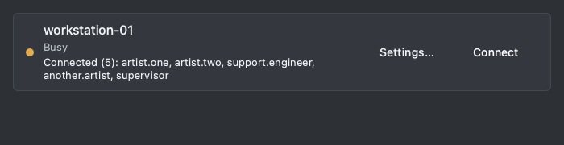

# Workstation connection visibility

The Remote dashboard now shows `Connected (N): user.one, user.two` beneath
workstation status. Names wrap without truncation and the list refreshes every
five seconds while visible. Each distinct authenticated username appears once,
even if that person has several streams open to the same workstation.

The broker adds `connected_users` to authorized `/v1/hosts` replies. Clients
send signed `/v1/hosts/{id}/presence` reports after the streaming connection
starts, every fifteen seconds while connected, and when the session finishes.
The report has a random 32-hex-character `connection_id`, positive integer
`sequence`, and boolean `connected`. The broker derives the username from the
session and requires host assignment plus a live direct grant or relay lease
for connected reports. Reports expire after sixty seconds without a heartbeat;
dashboard browsing cannot extend presence. Disconnect records reject delayed
heartbeats, and signing out removes the session's records immediately.

This is advisory Client presence. It does not attest Host streaming state,
identify physical desktop logins, change admission, or expose names in public
Host probes. Existing Clients do not send presence. Existing brokers omit
`connected_users` and may return 404 for reports, which new Clients tolerate.
Deploy the broker before distributing the updated Client. This change does not
bump versions, publish artifacts, or deploy services.

Local verification covers LAN and relay routes, multiple people and streams,
deduplication, logout, disconnect ordering, expiry despite dashboard refreshes,
assignment enforcement, address-bound grants, malformed payloads, caller-derived
names, signed request bodies, legacy brokers, and wrapped interactive cards.
Live workstation acceptance and native Windows qualification remain release gates.

The Apple Silicon Mac Client build (SDK27, macOS15 minimum) passes 36 Qt suites
with 725 cases. The focused card suite also passes after matching the app's
Material theme. Broker tests:123 passed. Root CI:117 passed with one platform
skip. The repository Ansible/YAML gate passes with existing lint advisories.

