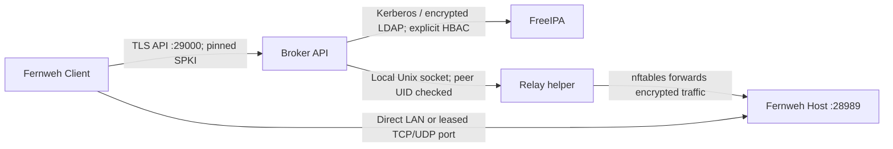

# Integrate the broker, directory and Hosts

The broker is an optional component of Fernweh. It is a FreeIPA/Kerberos
integration, not a turnkey identity provider or a generic OIDC/SAML/LDAP gateway.
Direct local PLANK connections do not require it. This guide uses reserved
example names; replace every identity, network and path with your own policy.

## Connections and trust



API authentication terminates at the broker. Media TLS/QUIC terminates at the
Host; the relay forwards encrypted packets and does not decode the desktop.
Client→broker trust uses administrator-distributed SPKI hashes. Broker→Host
probing pins the Host certificate; Client admission then verifies the exact
broker-provided Host leaf hash. Directory assignment and Host OS authorization
both remain necessary. A relay port alone does not authorize a desktop login.

## Prerequisites and build

Use a dedicated Rocky 9.7 Linux service machine with reliable time/DNS, reachable
FreeIPA KDC/LDAP servers, static network policy and an isolated test workstation.
MFA/password/passkey handling relies on FreeIPA's supported Kerberos flows;
verify your actual FreeIPA/SSSD versions and both OTP/passkey behavior before
exposing the endpoint. This repo does not ship BDE's directory installation or
custom KDC packages. Password+OTP is the initial integration path; passkeys and
remote enrollment can be enabled after their separate checks.

```sh
sudo dnf install gcc krb5-devel clang-devel pkgconf-pkg-config
cargo test --locked --release --manifest-path apps/broker/Cargo.toml
cargo build --locked --release --manifest-path apps/broker/Cargo.toml
```

The root Rust pin and Cargo lockfile select the toolchain/dependencies. The
`system` feature links MIT krb5/GSSAPI and uses LDAP SASL/GSSAPI. On macOS or a
source-only reviewer machine, use `cargo test --locked --no-default-features
--manifest-path apps/broker/Cargo.toml` for fake-backed logic tests. Those tests
do not replace native Linux/FreeIPA/relay acceptance.

## Directory policy

Use an administrative Kerberos session for these **one-time examples** on your
own test realm. Existing objects should be inspected and updated deliberately.
Do not copy a BDE inventory or make broad `allow_all` rules.

```sh
ipa group-add fernweh --desc='Fernweh remote users'
ipa hostgroup-add plank-remote --desc='Remote workstations'
ipa hostgroup-add-member plank-remote --hosts=ws1.example.org
ipa hbacsvc-add plank-remote
ipa hbacrule-add fernweh-artists
ipa hbacrule-add-user fernweh-artists --groups=fernweh
ipa hbacrule-add-host fernweh-artists --hostgroups=plank-remote
ipa hbacrule-add-service fernweh-artists --hbacsvcs=plank-remote
ipa service-add HTTP/broker.example.org
ipa service-add plank/ws1.example.org
ipa service-mod plank/ws1.example.org --auth-ind=otp
```

Hosts must exist in IPA, have directory DNS A records and, for Linux OS
accounts, the normal IPA/SSSD enrollment. Add intended users to the remote
group, configure their OTP authentication type and enroll their own factor
using your directory's administration/self-service flow. The broker computes
assignment from its configured hostgroup and **explicit enabled allow rules**;
`allow_all` and category-all rules do not create a broker assignment.

Set `ldap.hostgroup=plank-remote`, `ldap.hbac_service=plank-remote`,
`kerberos.host_service=plank`. Give the broker principal read/search/compare
access to directory DNS attributes (`objectclass`, `idnsname`, `arecord`,
`aaaarecord`), HBAC/group membership and relevant user policy. It needs **no
administrative password or general directory write permission**. For remote
enrollment, also grant read access to OTP ownership/disabled state under
`cn=otp,<base_dn>` (`objectclass`, `ipatokenuniqueid`, `ipatokenowner`,
`ipatokendisabled`, `managedby`) and user gate attributes (`krblastpwdchange`,
`krbpasswordexpiration`, `ipapasskey`, `ipauserauthtype`, `nsaccountlock`,
`memberof`). Never grant read access to `ipatokenotpkey`. Package these
read-only permissions in an IPA privilege/role assigned to the HTTP principal.

Provision separate keytabs once: `HTTP/broker.example.org@EXAMPLE.ORG` for the
API, `plank/ws1.example.org@EXAMPLE.ORG` for the Host. `ipa-getkeytab` can rotate
keys; do not repeatedly run it against an existing identity as a status check.
The broker needs realm/KDC mappings in `/etc/krb5.conf` (or its include directory),
`dns_canonicalize_hostname=false`, `rdns=false`, and the directory CA for
LDAPS/StartTLS. An LDAP bind alone is never proof of MFA.

For passkeys, configure the matching RP ID on broker and Client, install the
SSSD passkey Kerberos client plugin on the broker, and require/accept the intended
`otp` or `passkey` authentication indicator in both KDC and Host policy. Confirm
that your KDC preserves the OTP fallback when both methods are enabled.
Keep `[enrol] enabled=false` initially. Enable enrollment only after its group,
privileged-account exclusion, factor-presence, optional password-age and
self-service ACI gates pass. Password/token/passkey writes occur as the user,
not with the broker service principal.

## Service installation and runtime configuration

The deployable unit files and account definitions are shipped under
`apps/broker/packaging/`. Install the built binaries and unit definitions using
these paths; determine Cargo's output directory instead of assuming a private
maintainer path:

```sh
broker_target=$(cargo metadata --no-deps --format-version 1 \
    --manifest-path apps/broker/Cargo.toml | python3 -c 'import json,sys; print(json.load(sys.stdin)["target_directory"])')
sudo install -d -m 0755 /usr/local/libexec/plank-broker /usr/local/share/doc/plank-broker
sudo install -m 0755 "$broker_target/release/plank-broker" \
    "$broker_target/release/plank-broker-relay" /usr/local/libexec/plank-broker/
sudo install -m 0644 apps/broker/README.md /usr/local/share/doc/plank-broker/
sudo install -m 0644 apps/broker/packaging/sysusers.d/plank-broker.conf /etc/sysusers.d/
sudo systemd-sysusers /etc/sysusers.d/plank-broker.conf
sudo install -m 0644 apps/broker/packaging/systemd/*.service /etc/systemd/system/
sudo install -m 0644 apps/broker/packaging/sysctl.d/90-plank-broker.conf /etc/sysctl.d/
sudo install -d -o root -g plank-broker -m 0750 /etc/plank-broker
sudo install -o root -g plank-broker -m 0640 \
    apps/broker/packaging/broker.toml.example /etc/plank-broker/broker.toml
```

Edit the installed TOML **before starting services**: public endpoint, TLS paths,
realm, principal, directory CA/endpoints, allowed target CIDRs and enrollment
policy. Restrict relay destinations to actual workstation networks. Optional
`routing.direct_client_cidrs` selects office clients; routing is server policy,
not a Client-requested downgrade. Keep updates and diagnostics absent until
configured deliberately. For SELinux, apply normal `restorecon` to installed
binary paths as described in the [service reference](../../apps/broker/README.md#deploy-layout).

Generate/provision your own TLS key and certificate, keytabs and directory CA
outside Git. API keytab/TLS key: `plank-broker:root` mode 0400; configuration
`root:plank-broker` 0640; API state private 0700. The relay account must not read
the API's keys. The API has no capabilities; only the relay receives
`CAP_NET_ADMIN`. Use the supplied systemd sandboxes, not a root-run API service.

```sh
sudo -u plank-broker /usr/local/libexec/plank-broker/plank-broker check-config
/usr/local/libexec/plank-broker/plank-broker spki /etc/plank-broker/tls.crt
```

Distribute the verified public SPKI hash through the Client build settings or
administrator-controlled Client Settings. The example does not contain a usable
TLS identity or keytab. The first command also validates optional signing-key
access, so run it as the actual service user.

Network rules: clients reach API 29000/TCP and the configured relay port range
(default 29001–29100 TCP+UDP); broker reaches Hosts 28989 TCP+UDP and directory
Kerberos 88, password-change 464 and LDAP 636 (or 389 with mandatory StartTLS).
Persist IPv4 forwarding using the shipped sysctl file. Perimeter forwarding and
firewalld rules are administrator configuration; there is no automatic UPnP.
The relay owns only `inet plank_broker`; never flush unrelated nftables tables.
See [firewalld interaction](../../apps/broker/README.md#firewalld--nftables).
After confirming local firewall policy, load the specific sysctl file, reload
systemd and start relay before API. Do not enable another nftables service that
flushes existing rules on restart.

## Host admission

On a Linux test Host, install the fork's RPM and a root-owned 0600 keytab, then
set in `/etc/plank/host.conf`:

```ini
[security]
gssapi_keytab = /etc/plank/plank.keytab
gssapi_required_indicator = otp
gssapi_pam_service = plank-remote
```

Install the supplied `plank-remote` PAM account/session policy and authorize
that HBAC service. For a tested passkey deployment, the indicator list can be
`otp passkey`. MFA does not bypass OS account restrictions, root denial or
active-desktop ownership. Configure exclusive handoff/shared modes explicitly;
ordinary local-password PLANK access remains separate. Follow the Host's
[Linux GSSAPI contract](../../apps/host/linux/docs/plank-gssapi-admission.md).

For an unjoined shared Mac, use the complete
[signed-admission contract](../../protocol/macos-broker-admission.md): a separate
P-256 signing key private to the API, an exact directory-host→local-account
map and the corresponding public key installed in root-controlled Host config.
Directory HBAC assignment still applies. The Client cannot choose the local
account. An invalid capability never falls back to password/GSSAPI admission.
macOS signing, service setup and privacy permissions remain required.

## Acceptance and operation

Before allowing real users, verify an allowed and denied user, bad OTP, wrong
broker pin, changed Host certificate, expired/replayed device proof, direct
and relay routes, lease expiry/logout cleanup, API/relay restart and a real
Client session. Test password-only rejection at the KDC/Host, not only in the
UI. Use [the live acceptance contract](../../protocol/live-broker-acceptance.md)
and isolated credentials; fixture setup/teardown remains an explicit operator
action. This repository preparation runs no live fixture or deployment.

The CLI provides `pin list`, `pin reset <fqdn>`, `selftest directory --user
<user>` and `selftest kerberos --user <user> --host <fqdn>`. Reset a Host pin
only after independently verifying replacement identity. Keep audit logs and
session stores private; they contain operational metadata. Back up configuration
and key material securely. Test rotation/revocation rather than treating a
successful compile as proof of secure deployment.
