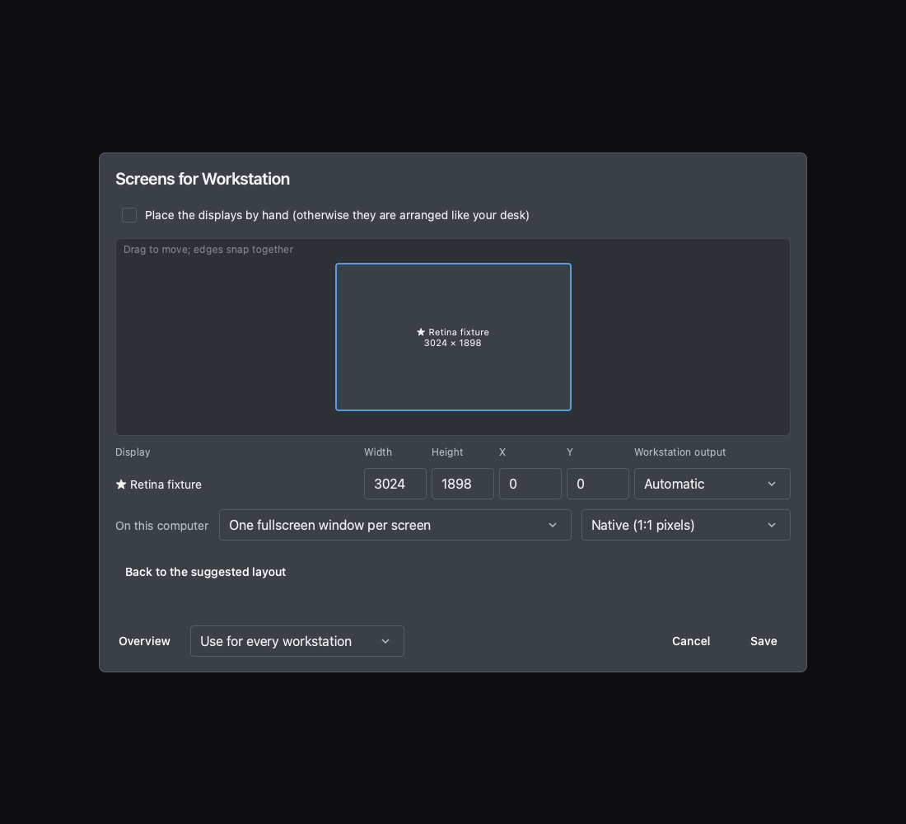

# Choose a desktop size

Open a workstation's **Settings → Screens** before connecting. Basic settings
show the screens you will use, the remote desktop size on each, and an **On next
connection** preview. A saved setup is reused for that set of local screens.

On a high-resolution screen, choose **Larger text** for easier reading. The
workstation renders a smaller desktop, which the viewer enlarges to fit your
screen. This gives you less workspace and can soften fine detail. It does not
add independent Retina text rendering to Linux applications. **More space**
uses the screen's full pixel size and can make controls very small.

You can also choose a listed resolution such as 1920 × 1080. Different screen
shapes can leave black borders because Fernweh preserves proportions. The
viewer fits the desktop to its window; changing resolution changes the remote
workspace, rather than changing the Mac's own display settings.

Turn a screen off to keep it local. Choose the primary screen for menus and new
windows. Check whether the setup will apply to every workstation or only the
one selected, then **Save** or **Save and connect**. Existing saved settings are
kept until you change and save them.

## Exact dimensions and placement

Open **Advanced** for custom width and height, manual positions, workstation
output preferences and viewer windows. Use even pixel values within the host's
supported limits. **Update preview** checks edited dimensions without closing
the dialog. **Save** also applies the field you are currently editing. Invalid
values remain visible and are not saved; **Cancel** discards unsaved edits.

The preview shows the planned result. Before a host's capabilities have been
retrieved it is marked as expected; the connection confirms supported sizes.
Choose a new desktop size here before connecting and reconnect to use a changed
saved setup. This Client update does not change the Host's handling of live
resolution changes made inside GNOME.

## Fixed desktop sizes

Hosts and video formats that require fixed layouts show a simpler editor. **Match
this computer** resolves the desktop automatically on each connection; it has
no editable resolution picker. Choose a fixed desktop instead to request a
specific resolution. These choices use the same single **Save** action.

A remote Mac preview includes its requested desktop mode and scale. Linux
hosts also offer existing physical screens or one/two virtual desktops. Their
optional advanced stream sizing changes encoded frame size, independently of
the desktop layout. Modern Linux hosts use individual screen sizes when the
selected video format supports them. Software formats without that support
show the fixed-size editor instead; choose **One virtual desktop** to request
an exact size such as 3840 × 2160. Save a changed video format in workstation
settings, then reopen **Screens** to review the controls for that format.

Changing video quality alone preserves a saved fixed layout. Workstation
settings show **Keep the saved fixed layout** while it is in use. Choosing
**Use my display setup** or **Custom for this workstation** is an explicit
change; opening Screens loads the chosen saved setup before you edit it.
