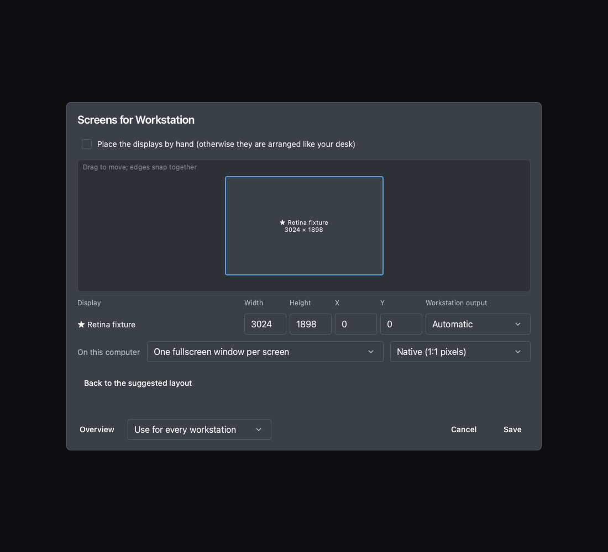

## 22 November 2026 — QUIC receive headroom

Candidate 1.2.52 from `0d49f29f` pins upstream Kymux `4ee4654` for
bounded receive-buffer requests and client-side reporting of the capacity
granted by the operating system. The encrypted media loopback reported
4 MiB on both macOS and Windows with Rust 1.99.1. The existing Quinn UDP
hook still supplies the native listener's request.

A Linux package variant applies the upstream change over the previously
qualified datagram-limit recovery changes. The exact transport test
executable passed six 150 Mbps trials and recovered all 5,400 frames with
zero test-owned socket drops. The Linux system-wide ceiling was unchanged.

The signed and notarized Mac candidate passed UHD60 direct-route motion
and input. Normal reconnect passed. A forced exit followed by a faster
retry still reached the active-session conflict. The Windows MSI passed
native component and packaging checks, and the Client launched in a real
desktop session. A fresh Windows streaming run remains open.

## 25 November 2026 — Plasma X11 display leases

The Linux Host pauses an already-running KScreen module while a display
arrangement is leased. On restore it resumes the same user-bus instance and
leaves saved desktop settings in place. Native NVIDIA qualification reproduced
the competing modeset and verified first-attempt exact-size capture with the
guard. Two macOS client connections delivered full-size video and input and
restored the desktop. The session-context suite passed all 19 cases.

The [Linux Host change](https://github.com/best-day-ever/fernweh-host-linux/pull/11)
is on Host main at `95ff558b`. The separately qualified
`1.2.54-kscreen-display-lease` backport uses Host `61c5adbf` and assembly
`3f8124c4` with the 1.2.43 greeter and transport baseline.

## 18 November 2026 — network diagnostics Client1.2.44

Broker producer PR25 and Client PR15 retain merge history. The coordinated
Client pin includes the fixed two-minute authenticated probe, capped streaming
HTTPS goodput, cancellation/retry guards and independent logs from windows
sharing a sign-in. The score preserves upload callback delays without claiming
that TCP backpressure proves a stalled Client; severe timing issues cap its
aggregate score.

Native verification:161 Linux broker cases plus the actual relay entrypoint;
49 Mac Qt invocations/943 passes/two expected skips plus native helpers,
transport and signed/notarized package gates;28 Windows suites/653 passes/five
expected skips plus transport, MSI and protected-service checks. The identical
Mac package launches on macOS15.7.4 and27; the Windows installer upgrades42→44
without changing protected preferences, sessions, services or boot identity.
Direct/broker/configured/direct-again deployment fixtures pass. An authenticated
live worker completes the full UDP and HTTPS plan and returns a private receipt.
Installed streaming/probe acceptance and hosted feed publication are recorded
separately; these source and package checks do not certify every employee's
hardware or network.

# Source review and publication record

Prepared 13 November 2026 for Finn's review. This is a source preparation of BDE
Fernweh as an enhanced PLANK fork. No new release version, binary asset, feed
publication, installed app or service deployment is part of this task.

## 17 November: Linux capture geometry repair

Host [9](https://github.com/best-day-ever/fernweh-host-linux/pull/9) validates
NvFBC dimensions and BGRA capacity before acquiring or copying an image. Invalid
frames request the existing complete capture reinitialization. Eleven focused
native tests pass; the actual-production snapshot fixture improves from two of
nine passing cases to nine of nine. Native logical-viewport grow, shrink and
reverse transitions produce five exact source/capture RGB matches, with layout,
power, preferences and service identities restored. This is standalone capture
evidence; installed streaming and input acceptance follow packaging. See
[1.2.43](../releases/1.2.43.md).

## 17 November: Windows fullscreen and requested diagnostics candidate

The final source also records bounded reconnect progress: first decoded frame
and surface dimensions, negotiated/requested geometry, and one two-second
visibility/import/draw/swap snapshot per generation. A controlled exposed UHD
reconnect resumes the retained decoder with matching3840×2160 dimensions and
live presentation progress. An earlier stale-picture observation had uncontrolled
window visibility and does not establish a decoder recovery defect. No additional
renderer reset is introduced. The out-of-tree Windows QML fixture lookup is fixed.

The integrated candidate restores the fullscreen flag, window-event flush
counter and cleanup-wait defaults lost during Qt/SDL reconciliation. Missing
SDL decoders are recreated from state; rejected barriers and reconnect drainage
cannot leave window events suppressed. Requested diagnostics add expiring,
account-scoped, bounded redacted application logs over the existing pinned,
device-bound connection and opt-out. See [operation](diagnostics.md),
[contract](../../protocol/client-support-diagnostics.md) and
[source version1.2.42](../releases/1.2.42.md).

Focused native Qt collector tests pass28 cases, including active-stream upload,
redaction, account changes, opt-out cancellation and checkpoint/poll contention.
Native Linux system broker tests pass144 cases plus relay integration. Four
operator tests pass. Root CI passes170 cases with3 expected skips. The native
Mac SDL bootstrap/barrier regression passes9 cases, including queue saturation,
filtered enqueue and reconnect drainage. Peer review finds no remaining source
blocker after independent retention and event-barrier corrections.

The configured native Windows integrated candidate passes615 cases across26
suites, zero failures and5 expected skips, plus2 UDP regressions and7 MSI/9
installer-helper paths. Its MSI builds successfully with protected builder
services preserved. A preserved earlier package passes three real fullscreen
round trips with fresh marker frames, while the affected package fails the
same fullscreen/freshness checks. The exact extracted MSI runtime passes28 source-pixel/Client-marker and window
state observations across startup, three fullscreen round trips and manual
disconnect/rejoin for both H.264 and HEVC10-bit4:4:4 at1920×1080. Exact-format
software decoding is verified; this sparse-marker test does not qualify60fps
performance. A separate early black startup observation is retained; controlled
untouched cold-start repeats and the paired final runs pass without a decoder
workaround. Final main-source package, normal-owner UHD, automatic network
recovery and installed-upgrade acceptance remain separate gates. The default
direct-only Windows build also passes421 cases across21 suites. No new binary
is promoted by this source receipt.

## 17 November: display setup compatibility controls

The Advanced display page now shows its fixed-layout section only for known
Hosts without display arrangements, including Mac Hosts. Arrangement-capable
Linux Hosts use the normal per-monitor resolution controls and one Save action.
The decision follows Host capabilities rather than the selected encoding, so
choosing a software encoding does not reveal the duplicate controls. Unknown
Hosts do not advertise compatibility controls before their capabilities are known.
Existing saved profiles and the fixed-layout implementation remain intact.

Client change `75cefd91` passes native Qt6.10.2/offscreen checks of the actual
dialog, controller and temporary QSettings: Looks like, preset and custom
Save/reload, plus rendered visibility for modern Linux, its software-encoding
fallback, older Linux, Mac and unknown Hosts (6 QtTest cases including setup
and cleanup). Monitor/decoder inputs and the broker API are fixtures; this is
not an installed streaming test. The13 deployment-validator cases and all four
direct/broker/configured/direct-again builds pass, each with7 QtTest cases;
invalid pins are rejected. Changed-content privacy and whitespace checks pass.
No Client installer, release feed or live deployment is changed by this source fix.

The initial1.2.39 Mac package passed build/signing/notarization but remained
unpublished after native GUI inspection found an inconsistent older capability
cache: pre-authentication server-info flags were stored beside a valid
authenticated arrangement description. The follow-up recognizes that valid
description in saved previews and caches future flags from the authenticated
topology snapshot. Its exact stale-cache fixture fails before the repair and
passes afterward; normal sizing/persistence and old-Host/Mac visibility remain
covered. The next Mac release is1.2.40 from a fresh main build. Live GNOME modeset
capture recovery remains a separate investigation.

## Review entry points

- [What changed over PLANK](enhancements.md), including inherited capabilities,
  downstream ownership and limits.
- [Every platform's source build](build.md), [operator settings](configuration.md)
  and [broker/Host integration](broker.md).
- [Claude/Codex development](development.md), [upstream contribution workflow](upstreaming.md)
  and [ancestry/license provenance](provenance.md).
- The parent `.gitmodules` pins Fernweh component repositories. Existing
  public nested dependencies retain their provenance.

## Verification receipt

Completed locally:

- The complete Mac Client developer build passes with SDK 27 and the macOS 15
  target: 39 Qt runs / 789 passing cases, plus native helper, passkey signature,
  microphone-fixture and audio-timestamp checks. Prepared dependencies were
  reused; this is not an empty-cache bootstrap or installed session test.
- Root CI: 120 tests pass. Broker logic: 138 tests, plus relay entry-point and
  private-key/configuration isolation checks, pass on macOS with fakes.
- Deployment validator: 9 tests pass. Both generic and operator configurations
  compile with pinned Qt 6.10.2 (4 Qt cases each); invalid pins fail qmake even
  with an existing generated header. An output path containing spaces passes.
- Both skill entry points validate. Local links in the README/contribution/new
  guides resolve. Changed-content privacy checks and Git whitespace checks pass.
- The bde-linux documentation gate passes with its existing lint advisories.

The initial Mac test attempt stopped on a relocated cached OpenSSL executable;
the final complete run uses `PLANK_TEST_OPENSSL` pointing to an independent,
working OpenSSL 3 CLI, as documented. The initial bde-linux gate lacked its
ignored vault-password-file path in the new worktree; its completed repeat
uses the existing external password-file setting without copying any secret.

Generic secret scans of imported history found 0 root, 2 Client and 5 Linux
Host findings. The latter point at inherited test/demo material and an old API
example. Detailed reports remain private for classification; this does not
clear historic operational text, media or hosting metadata for publication.

Private repositories were created with Actions disabled and merge commits
allowed (squash/rebase disabled). Final component review commits:

- Client: `f104fda954ea6b5d7a89b2e0bff87b0b4a001af1`.
- Linux Host: `cc51fa3e965706cef016d2498d16649fe9c5ee96`.

The final parent Git tree pins those exact component commits. A separate authenticated GitHub clone of implementation commit `6bbef3f5`
checked out those exact private Client/Host pins, the shared transport, and both
recursive Client dependencies. All initialized repositories were clean; imported
source commits remain ancestors. The deployment validator also passes from that
fresh clone. Linux Host's additional build dependencies were deliberately not
recursively downloaded during this source-only verification. This final receipt
changes documentation only.

Cross-platform product builds, signed installers and live streaming are not
implied by source/configuration tests. Existing BDE release notes retain their
original scope and do not qualify bytes built from this repository.

## Initial publication requirements (historical)

The initial preparation required keeping maintained repositories private until
Finn explicitly approved publication. That authorization was given on 14 November;
the subsequent audit is recorded below. The original requirements were:
Review the full reachable histories and hosting metadata for secrets and private
operational information, including binary screenshots and every maintained
submodule; current-tree checks are insufficient. Verify license notices and
vendor SDK redistribution boundaries. Confirm a fresh clone of the exact parent
and gitlinks, repeat the target-platform build on the appropriate builders, and
record unrun hardware/session checks. Decide GitHub-native fork metadata and
public contribution branches separately from source ancestry.

Hosted Actions remains disabled for private review. No upstream submission is
made until separately authorized. This review does not change BDE's existing
source repositories or automatically switch its build/deployment pins.

## 14 November: optional broker build profiles

`FERNWEH_BROKER_ENABLED=0` is now the default direct-only Client. `1` explicitly
includes broker networking/account UI, session/device-key stores, enrollment,
the passkey helper and optional updater. Direct Host access and shared display
setup remain available in both builds. A disabled product ignores inherited
broker deployment values and saved broker preferences without erasing them.
The guides describe independent Client, Host and broker/relay executables.

Both complete Mac Client developer builds pass with SDK 27/macOS 15 target:
35 Qt runs/609 cases direct-only, and 39 runs/792 cases broker-enabled, plus
native helper/input/audio checks. Direct build used stale broker environment
values and a deliberately stale passkey helper; no broker backend symbols or
helper remain. Enabled build has its backend and helper. The binary checker
rejects either executable when asked to verify the opposite profile.

13 validator cases and 4 successive configuration/resource builds (direct,
broker without an endpoint, configured broker, direct-again) pass. They verify
compiled resource presence, shared launcher/settings/streaming QML compilation,
saved-preference preservation and invalid configuration rejection. Shared
display setup remains present for direct sessions; its broker actions are
selected separately. Root CI 120 (one platform skip), skill/privacy/whitespace
checks and the bde-linux gate pass with existing lint advisories. Native
Windows/Linux builds, installed sessions and signed distribution are unrun.
No deployment, public visibility change or binary release is part of this work.

Client change [PR2](https://github.com/best-day-ever/fernweh-client/pull/2) is merged with preserved history as `19adb7e8247da99f5dbe5c2e99e4f5b3d0560bb7`; the parent pins that exact commit.

## 14 November: feature showcase and upstream review

The root README now presents the display matcher, creative input, specific
reliability fixes, optional studio access, build choices and contribution path.
Two screenshots render the actual pinned Client's overview/advanced QML using
fictional display data, with capture source and provenance in [media](media/README.md).
Both complete pages were visually checked. This does not run a real session.

The [upstream comparison](upstream-review-2026-11-14.md) uses fresh parent,
Client and Linux Host `main` fetches, inspects the relevant diffs and current
Fernweh call sites, and prioritizes missing recovery/request/backpressure work.
Exact 60 Hz timing is attributed upstream. Immersive mouse is explicitly under
review in separate BDE PRs and is not represented as included at the current pin.
No product source, dependency pin, runtime service or repository visibility is
changed by this documentation work.

The capture program builds and renders both pages without QML warnings. A
GitHub-Markdown preview passes at 1440px desktop and 390px phone widths, in
light/dark themes, with all images loaded, jump links resolved and no page
overflow or JavaScript errors. Local document links/anchors and the ancestry
of cited included implementations pass; PNG metadata, SVG syntax, shell syntax,
changed-content privacy and whitespace checks pass. The bde-linux repository
gate passes with its existing lint advisories. Product builds were not repeated
for this documentation-only change.

## 14 November: source merges and focused upstream repairs

The original immersive chain is merged in its five BDE component/parent PRs;
parent `54ee7b9c` pins the actual merged Client and Host revisions. Private
Fernweh Client PR3 / Host PR4 integrate those changes while preserving broker
configuration and the prior fork fixes. Client PR4 adds retiring-session retries;
Host PR5 adds coalesced NVENC refresh requests, request/audio bounds, mapped-key
cleanup and non-finite pen rejection. Current component review SHAs are recorded
in the manifest. Merge commits remain intact.

The parent backports reliable-data backpressure without changing its transport
versions, plus PLANK 1.4.18 Mac display wake / incomplete-first-setup recovery.
Transport unit/wire results: 72+6 pass. Encrypted functional connections: 11 pass,
including reliable bursts in both directions, sharing, authorization,
cancellation, microphone and camera. Mac wake recovery: 37 checks; readiness: 378
checks across 9 cases; authenticated topology/retry/timeout checks pass. The
changed Mac Session compiles with SDK 27 and deployment target 15.0; its existing
bounded/continuous/status reconnect policy fixture passes. These focused ports
have not been built into a new signed package or deployed.

The standard Mac packaging script still selects the SDL frontend. The merged
immersive source currently requires the Mac Qt frontend and Linux X11 Host;
turning it on in the standard build requires display/clipboard/sharing parity.
Installed Blender/Unreal acceptance is still open. The wholesale 1.4.18 upgrade
remains an unfinished private integration branch. The
[integration ledger](upstream-integration-2026-11-14.md) lists its blockers and
release coverage; this receipt does not claim that every upstream change landed.

Generic default-branch dependency proposals that discard PLANK native input were
rejected. The GoogleTest proposal was a verified 1.17.0→1.14.0 downgrade and was
rejected. The upload-artifact 7.0.2 SHA matches its official tag. A fourth private
repository, `fernweh-common-c`, preserves the combined input-library source for
the future coordinated upgrade; its 8 C tests pass. Current focused builds retain
the earlier native library pin. All review repositories remain private, hosted
Actions are disabled, and no binary, feed, fleet pin or runtime service changes.

The native Linux Host builds successfully: 106 focused cases pass, with 3 kernel
UHID cases skipped. The two HTTPS regressions pass separately with an ephemeral
loopback TLS identity. A shuffled 25-run input/pointer/context/scheduler repeat
passes 54 cases per run, with 2 UHID skips per run. The Mac preview gate reaches
real TLS/QUIC display-lease recovery and three-peer shared-desktop checks; its
administrator-only handoff fixture then stops because this runner has no
passwordless sudo. That remaining fixture is not reported as passed. Privacy,
local Markdown targets and 13 build-configuration regressions pass.

## 14 November: developer documentation and publication audit

Finn authorized publication after checking Git and its history. The README now
uses developer-oriented descriptions and includes knocking/owner consent,
view/control roles, multi-user sharing, independent workstation sessions,
presence, files/folders, clipboard grants and recovery, support policies and
smaller reliability fixes. [The implementation map](enhancements.md) provides
source/contract boundaries; [the history index](merged-history.md) verifies
232 original merged reviews by reachable merge/source-head ancestry, plus
10 post-import Fernweh reviews. Imports/releases/tests are labeled as such,
not counted as distinct downstream features. Existing real QML screenshots
retain their fictional-data provenance.

Publication audit scope: `fernweh`, `fernweh-client`, `fernweh-host-linux` and
`fernweh-common-c`, including advertised branches/tags and PR head/merge refs.
Each repository was audited separately; gitlinks do not substitute for scanning
the nested histories. Inherited public dependencies retain their pinned sources.
The native-input repository main supports the unfinished coordinated upgrade;
it is not the current Client main pin.

- Gitleaks **8.30.1**, default rules plus the repository SSH-password rule,
  all-history patches, no baseline/local ignore suppression, and inline allow
  comments ignored. Reports were redacted and retained outside Git.
- An independent object pass scanned every reachable blob, commit message and
  annotated-tag object: **11,770 commit objects and 34,679 blob objects** across
  the four repositories, approximately **1.67 GB** of content. It also checked
  credential literals/URLs, private-key markers, LFS pointers, private filenames
  and documentation/deployment identifier heuristics. No LFS pointers were found.
- The seven historical patch findings resolve to Client loopback TLS test-key
  material and a synthetic GSSAPI token, inherited Sunshine test/pairing/demo
  keys, and a placeholder curl authentication example. The object pass sees
  repeated versions of the same material; three additional Sourcegraph-rule
  hits are audit-generated object SHA markers, not source credentials. No broad
  test-directory allowlist was introduced.
- Identifier findings were reviewed as synthetic network/RP validation tests,
  inherited software-version strings, canonical address ranges and upstream
  Docker/configuration examples. No unresolved operational inventory finding
  remains in the publication scope.
- Binary inventory and provenance were checked. Client historical libraries,
  translations and shaders and Host fonts/images are inherited upstream objects;
  downstream Client icons/screenshots, Host EDID fixture and parent media were
  reviewed separately. Screenshot accounts/hosts are fictional or loopback data.
- GitHub-visible PR/issue bodies, comments and release metadata passed separate
  secret and privacy scans. Authenticated API-only temporary clone credentials
  were excluded from that public-metadata input. The repositories have no wiki,
  release assets or Actions artifacts. Hosted Actions remain disabled.

No unresolved credential findings remain in the reviewed scope. This audit does
not change runtime trust, claim new hardware qualification or certify a new
binary release. Private reports, source excerpts and credentials are not
published. Visibility changes and final anonymous-access verification are
recorded below after execution.

### Publication completed

On 14 November 2026 all four repositories were changed to public:
[Fernweh](https://github.com/best-day-ever/fernweh),
[Client](https://github.com/best-day-ever/fernweh-client),
[Linux Host](https://github.com/best-day-ever/fernweh-host-linux), and
[native input](https://github.com/best-day-ever/fernweh-common-c).
Fresh unauthenticated API reads confirmed each public repository and exact
reviewed commit. Actions remain disabled; merge commits remain enabled and
squash/rebase disabled. No original BDE repository was republished or rewritten.

Client [PR6](https://github.com/best-day-ever/fernweh-client/pull/6) and Host
[PR8](https://github.com/best-day-ever/fernweh-host-linux/pull/8) update their
public-status README/agent text only. Parent gitlinks advance to those merges,
`98378b99` and `663cc6ae`; product source is unchanged. Their changed-content,
commit privacy and whitespace checks pass. The complete-history snapshot above
precedes these documentation-only commits; subsequent additions pass the
same privacy checks.

The actual GitHub-rendered README passes 1440px/390px, light/dark checks: three
images load, local jump links resolve and article content does not overflow.
Desktop/mobile renders were visually reviewed. Local documentation checks pass
139 links/anchors; all 232 original review source commits are verified ancestors
of the recorded component source. The bde-linux repository gate passes with its
existing lint advisories. Product builds were not repeated for documentation.

### Historical automation records

Disabled Actions does not imply an empty run history. A final inventory found
12 archived **Dependabot update** runs: six parent, three Client and three Linux
Host; native input has none. All 12 run/job records and downloadable log archives
were reviewed with Gitleaks 8.30.1 (archive traversal enabled), with zero findings.
A separate deployment-identifier check of the archived logs also has zero
matches. These are dependency-update records, not product build qualification.
There are still no Actions artifacts, and Actions remain disabled. Private
copies of the raw records/logs stay with the external publication audit.

## 14 November: Windows port credit and implementation catalogue

The README now identifies the Windows Client port as a first-class downstream
addition, using Moonlight Qt's Windows foundation. Original Client `57932ae7`
adds native MSVC transport/build integration, DPAPI broker storage and graphics/
display changes; parent `97ff1875` adds build/dependency/staging scripts and
`6471486a` adds the WiX MSI. Current platform, contribution and source-build guides
no longer call the implemented Windows Client future work.

The [detailed catalogue](change-catalogue.md) and JSON evidence separate 191
change records across 15 areas with 262 implementation references. This includes
the original optional Mac normalized-pen adapter and smaller fixes inside PRs.
The source walk covers 611 non-merge commits outside recorded upstream tips;
it includes docs/tests/imports/repeated patches and is not a feature count or
an authorship claim. The existing 232-review index remains complementary.

Validation: all 262 source references are ancestors of the recorded snapshots;
232 original review references and local documentation links/anchors pass. Representative
port/enrollment/rendering changes were inspected in source. Actual GitHub
README renders pass desktop/mobile and light/dark checks; the catalogue renders
all 15 tables on mobile with resolved anchors and no article overflow. Images
load and the desktop/mobile pages were visually checked. Privacy, commit and
whitespace checks pass; the bde-linux repository gate passes with existing
lint advisories. Product builds are not repeated for this documentation-only
change. No product source, dependency pin, workflow setting or binary changes.

## 15 November: coordinated PLANK 1.4.18 integration

The candidate reconciles current Fernweh main, its platform adapters and the
coordinated
transport/dependency changes. Source checkpoint: parent `8911ad1d`, Client
`d7c5155c`, Linux Host `503fc870`. The runtime transport repair is already in
`ef1cc84c`; later changes add test preparation, artifact selection and receipts.

At this native checkpoint the source reviews remained drafts: [parent 6](https://github.com/best-day-ever/fernweh/pull/6),
[Client 5](https://github.com/best-day-ever/fernweh-client/pull/5), and
[Host 7](https://github.com/best-day-ever/fernweh-host-linux/pull/7).
No installer feed, deployment pin, installed product, driver, desktop or
persistent workstation policy changes are part of this work.

### Upstream triage

Upstream Client `121ed3eb` and Linux Host `c71333d7` remain the reviewed tips.
Parent `4a1c1046` adds only HANDOFF/signing-policy housekeeping after `2712269c`.
No additional product series is imported. Kymux stays at canonical upstream
`9e1a7e30`; there is no upstream push or new dependency fork.

### Reconciled behavior

- Qt display planning retains saved monitor identities, primary selection, crops,
  physical/virtual backing, shared views and Apply/Keep. Layout acknowledgement
  precedes decoder probing; shutdown cancels pending handoffs. Bookmark sizing
  uses selected displays while profile planning retains all monitor probes.
- Qt clipboard callbacks retain focus, generation, permission and adapter lifetime
  without SDL polling. File selection and changing participant permissions reach
  actual controls. Add/Edit bookmarks preserve stable saved layout values and
  discovered Host policy.
- Native local Q/T shortcuts run before the bounded remote queue. Queued Qt
  actions recheck focus/capture and disappear after object destruction. Repeat,
  key-up, permission revocation, toolbar pin and five-second idle hiding are covered.
  Narrow toolbars shorten version text while keeping status visible.
- Windows retains its SDL decoder/pacer, D3D resources, lifecycle callbacks and
  microphone adapter. Retired AV1 protocol branches are removed from retained
  renderers. Shared timestamps use one clock; software fallback remains limited
  to the exact selected codec/profile.
- Linux capture shares one C++/NVCC image definition after Native10 added metadata.
  Retained CUDA declarations, stale HDR code and HTTP test version scoping are
  repaired. A real compiler-boundary regression fails with the old image layout.
- Mac Host display operations run outside the admission lock and retain the first
  shared owner's workspace until final drain. Metrics remain disabled by default;
  startup/configuration/installer checks preserve their filesystem boundaries.
- Native build phases do not install OS packages. Source-first FEC and attestation
  use Cargo's actual artifacts instead of guessing among shared-cache outputs.

### Native evidence

| Gate | Result |
| --- | --- |
| Parent checks | Mac root suite: 157 passed and three Linux staging skips (160 total). All seven staging/manifest cases pass natively on Linux. Declaration-only Host headers pass eight C/C++ checks. |
| Transport | 88 unit and six wire cases; 47 selected protocol/encrypted functional and four actual source-first FEC cases pass. |
| Mac Client | Both complete profiles pass with SDK 27/macOS 15 target: direct 42 QtTest invocations / 701 passes; broker 46 / 884, each with two Linux-only skips. Actual production Qt/Metal 8/10-bit, crop, overlay, area reduction and native window checks pass, along with microphone/wire/timestamp and bundle checks. |
| Windows Client | Both native applications and full runners pass at `622f780b`: direct 19 suites / 386 passes; broker 24 / 572 with five expected skips (three POSIX-only and two unavailable real-helper fixtures). Sixteen updater checks use process probes without installation. Protected service and worker fingerprints remain unchanged. |
| UDP socket policy | Two real tests pass on each platform. Mac/Windows accept a 4 MiB request and preserve an existing 8 MiB buffer. Linux reports its actual clamped capacity; rejected requests retain a working socket. The exact locked `quinn-udp 0.5.16` source, licences and provenance are vendored with an opt-in feature. |
| Linux Host | Production and complete test binaries link. Focused checks pass 123 cases with three kernel-UHID skips; 25 input/lifetime runs pass 107 each with those skips; 25 wrapped lifecycle runs pass 97 each without skips. Exact CUDA 8/10-bit GBR/NV12/P010 and all three Native10 normal/Clang sanitizer fixtures pass. GCC 14 remains the product compiler. |
| Mac Host | Actual synthetic TLS/QUIC authentication/admission, display-lease restoration, three-peer sharing and cancellation pass; cancellation takes 0.01 seconds. Installer checks pass 47 cases; native configuration and 19 filesystem/configuration checks pass. Full privileged/installed Host qualification is separate. |
| Linux controlled-loss/package gate | All six 900-frame matrices and ordinary-user transport/FFI pass at `0ca8fd41`. The candidate RPM passes all uninstalled package gates at `8911ad1d`, with the accepted test ELF unchanged. No installation or release promotion. |

The focused Client evidence includes planner 55, sizing 13, layout 10,
connectivity 65, Host choices six, clipboard 23, native keyboard 35 and QML ten.
Qt input passes 27 cases with two Linux-only skips. Earlier pointer/input code
also passes 25 repeats. These counts are regression evidence, not feature counts
or installed-session acceptance.

### Receive loss and controlled measurement

The custom native listener omitted Kynet's canonical 4 MiB send-buffer bound.
The unchanged 1,600,013-byte C ABI frame test fails at the old 1 MiB default and
passes in both trust modes after repair, without changing payload, deadline or pacing.

The complete native repeat exposed a separate receiver issue: one frame failed
at 3% injected loss. A later unchanged run recovered all 900 frames but recorded
34 endpoint kernel drops despite zero proxy drops. After the product's bounded
receive request, another repeat still measured 76 endpoint drops under the OS
clamp. Preserve those failures. They prove proxy-only counters were insufficient;
they do not solely attribute the earlier frame failure or the historical deployed
motion-loss issue to this path.

The maintained gate now checks the three exact owned UDP sockets and reports
frame/FEC metrics before rejecting kernel loss. The default non-root path stops
before timed frames if effective receive capacity is below 4 MiB. The ordinary
Linux clamp is 425,984 bytes; the prepared test sockets report 8,388,608 each. A separately
reviewed fixture-only runner can use `SO_RCVBUFFORCE` on those three sockets,
with only two selected test cases from one hashed ELF invoked with elevation. Cargo,
compilation, packaging and Host build commands remain unprivileged. Runtime
services are untouched. A fixed
outer process timeout leaves protocol/frame/FEC deadlines unchanged.

The final six VBR/CBR matrices recover all 5,400 frames with zero unrecovered
symbols and zero owned kernel drops. All five phase/performance checks pass
without changing bitrate, pacing, FEC or deadlines. The shipping-feature test ELF
is SHA256 `b5f587dbc3961e29c937d6f56f8808ef5b8dd347869ea60585f9e6199d52a22b`.
The ordinary-user transport/FFI gate and eight focused socket cases use that
same ELF. Two mandatory Quinn constructor tests also pass with pinned Rust 1.99.1.
Global receive limits/defaults, existing socket capacities, protected processes,
timers, boot, GPU and configuration remain unchanged.
No global receive setting was changed; the earlier ceiling proposal was previewed
only and rejected before execution. No persistent privileges or sudoers changes.

An earlier standalone Cargo invocation ran from the SSH home directory with
`--manifest-path`, selecting Rust 1.99.0 instead of the source pin. Those focused
results are investigation evidence only. Four incompatible unhashed Kynet/Kyproto
outputs were recorded and quarantined; their replacements and the accepted
shipping ELF verify Rust 1.99.1. The shipping runner already selected the source
directory. Standalone native entry points now do so explicitly too: a manifest
path selects the Cargo project, not rustup's directory toolchain. The repair used no broad cache
purge or new target directory.

The packager no longer copies the retired blanket `build/assets` tree. Explicit
collaboration-helper, EDID and licence installs remain strict; behavioral staging
checks accept a clean build, reject a missing required helper and exclude stale
web assets. The ordinary-user package gate at `8911ad1d` passes manifest,
private-binary, log-directory, collaboration, configuration, Wacom, display,
UPnP, build-path and ghost-file checks. The local candidate is
`plank-host-1.2.36-0.plank_1_4_18.1.el9.x86_64.rpm` (7,355,808 bytes), SHA256
`441b506f7cb06e6dce4e1fd5c9845f3c1df6c79951c0abf17657dc746c4b1afd`.
It is an uninstalled qualification artifact, not a published release. The
accepted test ELF and protected/global state remain unchanged; temporary root
scratch is removed. Timed trials were not repeated for this packaging-only fix.

### Remaining acceptance

Keep the native source/package results separate from installed streaming.
The physical Linux desktop remains 24-bit; device-free Native10/CUDA tests do
not prove live depth-30 X11 capture. Privileged Mac handoff remains unrun without
a suitable test environment. Actual macOS 15/27 Client and 26.7/27 Host sessions,
Windows streaming, display sleep/lid, shared input/tablets, Blender/Unreal
immersive workflows, release soaks and Linux Client qualification remain open.
No source-main promotion, installation or binary publication follows from these
uninstalled checks. Hosted Actions remains disabled. Raw receipts stay in
owner-private audit storage; technical evidence stays in the repositories.

## 15 November: source promotion and release preparation

The operator subsequently authorizes proper PR merges and deployment. Source
integration is distinct from binary acceptance: [Host7](https://github.com/best-day-ever/fernweh-host-linux/pull/7)
merges as `7cf682dc`, followed by [Client5](https://github.com/best-day-ever/fernweh-client/pull/5)
as `95460128`. Their reviewed trees are preserved, including the named 1.2.37
Client notes. [Parent6](https://github.com/best-day-ever/fernweh/pull/6) pins the
actual published component merges. Shared version 1.2.37 is reserved; no release
asset, installed product or feed is promoted by these source merges.

Renewed configured Client checks pass Mac 884 and Windows 572 cases, with their
recorded two Linux-only/five Windows broker skips and two socket cases each.
The private Windows candidate also passes actual MSI identity, complete payload,
service extraction and limited-user ACL gates. The private Linux candidate
passes native source/input/lifecycle/transport/FFI and strict uninstalled RPM
checks. Its runtime and exact shipping-feature test ELF match the accepted
six matrices, so version/docs/staging-only changes do not trigger a timed rerun.
The canonical input repeat selects 105 passes/three kernel-UHID skips; the prior
expanded 107-pass audit additionally selected the CUDA-layout and retained-IDR
scheduler regressions. No selection or threshold was weakened.

Release preparation repairs two staging contracts. Windows no longer copies a
licence from the removed h264bitstream library, while retaining the Client
licence and strict new-output checks. Mac deployment previously failed on unused
SQL drivers before its post-deployment cleanup could run. A copied deployment
tool and private `qt.conf` now select a SQLite-only SQL view, preserving other
plugin categories and original Qt paths. Twelve executed process/filesystem
cases and real native deployment pass; 107 binaries meet closure/macOS 15 checks,
and bundled offscreen QML/SQLite load successfully. Qualified Qt content remains
unchanged and the exact scratch is removed. No dependency error is ignored.

The UDP constructor hooks select the existing machine-wide shared Cargo target,
preventing source-local artifacts on builders without a global target setting.
Six executed hook cases preserve locked/offline/release/features, source cwd,
two jobs and the mandatory two-test result. Actual native socket checks pass.
The parent root suite reports 166 tests: 163 passes and three native-Linux staging
skips on Mac. All seven staging/manifest cases pass on Linux. Sixteen collector
cases pass after correcting an old padded-version fixture to use the canonical
DMG identity; the production collector is unchanged.

Final installers must be freshly built from merged main, with signatures,
notarization where required, immutable provenance and exact hashes. Do not
relabel a feature candidate as a main build. The installed-session/hardware
acceptance listed above remains open before binary promotion. Source is ALPHA;
these merges do not certify a new installed streaming release.

## 16 November: Windows immersive mouse

Client implementation `fb77f588` adds the SDL adapter for Windows, the live
Mouse control and Ctrl+Alt+Shift+M. Capture is off each session, capability-gated
and unavailable to collaboration guests. Reliable END acknowledgement precedes
absolute reanchoring; bounded pending input keeps its ordering. Focus loss,
reconnect, window/layout changes, tablet takeover and teardown cancel capture.
Raw tablet enqueue shares the capture-start ordering boundary.

Native MSVC/Qt6.10.2 builds pass for both profiles. Broker-enabled tests report
25 suites/598 passes/five platform skips; direct-only reports20 suites/412
passes/no skips. Both include22 capture-state and17 shortcut cases and the two
real UDP socket checks. Broker updater validation adds seven MSI identity cases
and nine helper paths. The first SSH secure-session test fails because that
public-key logon lacks DPAPI access. The unchanged real secure-session and CNG
tests pass with the existing signed-in user's limited token; the initial failure
is retained. No key permissions or encryption were weakened.

The candidate launcher reaches its ready state with a responding native window
and an isolated portable profile. Focused Mac component checks pass22 capture
and17 shortcut cases. Root checks pass166 cases with four platform skips;
deployment generation passes13. Changed-content privacy and whitespace checks
pass separately in Client and parent.

Windows physical mouse/tablet, live stream toggle/release/reconnect, Blender,
Unreal and multiple-display acceptance remain open. Build, component, startup
and package checks support an ALPHA update; they do not certify those workflows.
The existing Mac and Linux Host packages retain their independent pins.

## 17 November: display setup clarity

Client display setup now starts in Basic, with readable high-resolution size
choices and a persistent next-connection preview. Advanced owns exact dimensions,
placement and output preference. Save collects the entire dimension form before
replanning, validates it without partial mutation, and also commits a focused
field. Cancel and Escape discard unsaved edits. Existing profiles remain intact.

Modern Linux sessions fit the desktop in their viewer irrespective of the
old profile scaling field. That unused picker is removed from their editor;
compatibility hosts get a separate editor and the same single Save action.
Automatic compatibility matching no longer offers a manual resolution it would
ignore. Known arrangement-capable hosts also reject fixed-layout writes in the
controller. Mac compatibility previews use the connection's window/fullscreen
viewport and desktop-scale resolver.

The new isolated QML/controller suite passes18 cases, including Retina and
standard-DPI choices, persistence, focused Save, invalid geometry, Cancel,
capability-cache gating, compatibility Save and selected/primary screens.
Synthetic renders were inspected at1100×1000 and900×700; their smaller-window
Basic preview and controls remain visible. The Mac release script now runs
this suite. Direct, broker, configured and disabled-again resource compilation
and root checks are recorded with the release. Probe/decoder/broker fixtures
are distinct from native GUI and live-stream hardware acceptance. No Host
capture fix or new streaming qualification is claimed.
# Ongoing diagnostic reception

An explicitly configured diagnostics section may use `enabled_until_unix = 0`
for ongoing collection. An absent section remains disabled; positive cutoffs,
private retention, device proofs and all existing quotas remain effective.
Summary and support routes use the same collection-window predicate. This is
a broker-only extension and does not require another Client build.

The fake-backed focused suite passes 13 diagnostic cases, including exact
expiry boundaries and authentication on all three ongoing-collection routes.
Native testing passes 146 broker cases, then identifies an old entrypoint
fixture treating zero as invalid. The updated fixture requires an explicit
cutoff, accepts ongoing reception, and retains relative-path and private-key
isolation checks. The complete native gate must pass before deployment.
Native system-feature tests, installed reception and scheduled collection
acceptance remain deployment gates; source merge does not claim those results.
