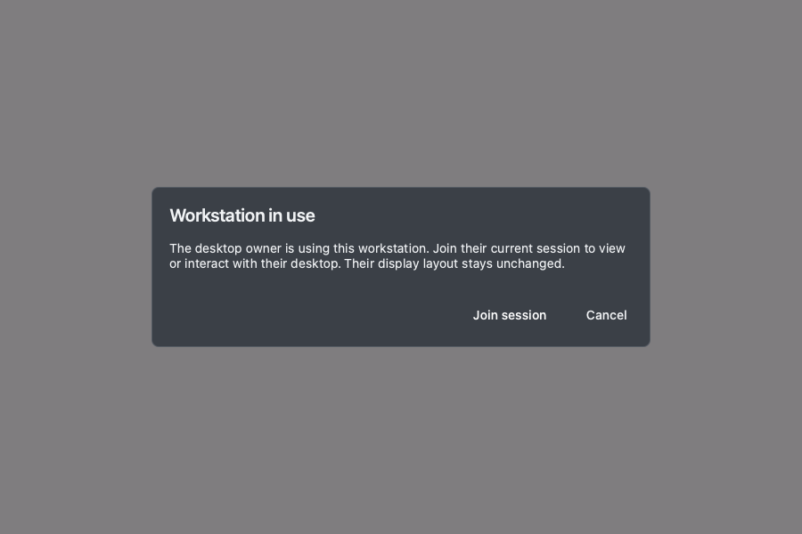

# Unreleased BDE Fernweh changes

## Shared desktop wording

The shared-desktop action reads **Join session**. Its explanation, joining status
and retry messages no longer imply that every join needs the desktop owner's
approval. The Host still enforces its configured access and approval policy.

This source-only change is queued for the next Client release. It does not bump
`packaging/VERSION`, build or publish an installer, update a feed, or change the
Linux Host or broker.

Validation: the native Qt collaboration suite passed all 13 cases, including
join/cancel choices, permission handling and display placement. The parent CI
suite passed 117 cases with one platform skip. The actual QML dialog was rendered
and visually checked with generic fixture text:

